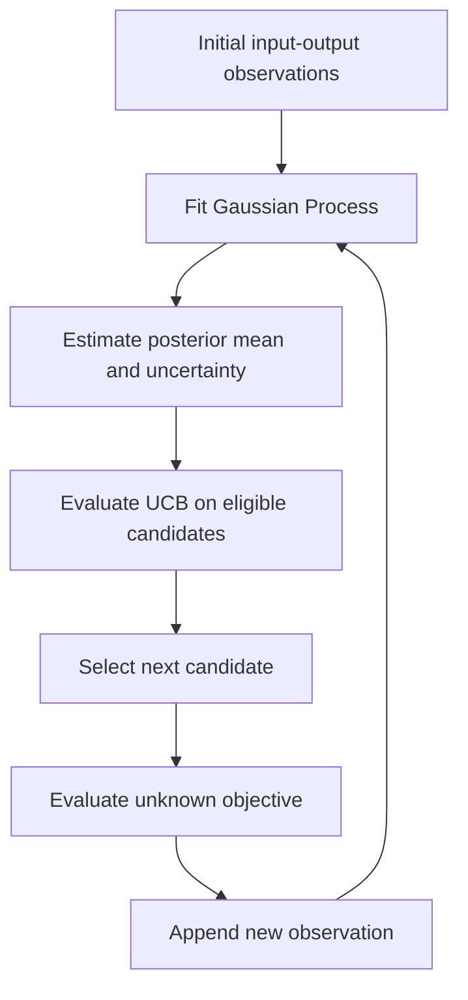

# Black-Box Optimisation Lab

### Sequential Bayesian optimisation with Gaussian Processes

**Eight unknown objective functions · 2–8 decision variables · 12-week capstone**

[](https://www.python.org/)
[](#methodology)
[](#project-at-a-glance)


> **Research question:** How can we efficiently maximise unknown, expensive-to-evaluate functions—and how can we recognise when a surrogate-based optimiser is no longer providing reliable guidance?

This repository documents a black-box optimisation (BBO) capstone built around **Gaussian Process (GP) regression** and **Upper Confidence Bound (UCB)** sequential sampling. Its emphasis is not only on finding good objective values, but also on understanding the *decisions*, *uncertainty* and *limitations* of the optimisation process.

## Contents

- [Project at a glance](#project-at-a-glance)
- [Problem formulation](#problem-formulation)
- [Methodology](#methodology)
- [Observed leaderboard performance](#observed-leaderboard-performance)
- [Results dashboard](results-dashboard/RESULTS_DASHBOARD.md)
- [GP predictive diagnostics — Phase 3](results-dashboard/diagnostics/GP_DIAGNOSTICS.md)
- [Sequential GP validation — Phase 4](results-dashboard/diagnostics/sequential-audit/README.md)
- [Function 7: uncertainty and kernel diagnostics](results-dashboard/diagnostics/f7-analysis/F7_DIAGNOSTICS.md)
- [Case study: Function 1](#case-study-function-1)
- [Evaluation philosophy](#evaluation-philosophy)
- [Repository contents](#repository-contents)
- [Limitations and research roadmap](#limitations-and-research-roadmap)
- [Documentation and reproducibility](#documentation-and-reproducibility)
  
## Project at a glance

| Aspect | Description |
|---|---|
| Goal | Maximise each unknown black-box objective under a restricted evaluation budget |
| Problems | Eight functions, F1–F8 |
| Input dimensions | F1: 2; F2: 2; F3: 3; F4: 4; F5: 4; F6: 5; F7: 6; F8: 8 |
| Decision-variable domain | Normalised continuous inputs in `[0, 1]` |
| Surrogate | Gaussian Process regression with Matérn covariance |
| Acquisition | Upper Confidence Bound (UCB) |
| Exploration parameter | `κ = 1.96` in the documented baseline |
| Experimental setting | Initial observations followed by sequential evaluation rounds over a 12-week capstone |
| Primary outcome | Best objective value observed, rather than a certificate of global optimality |

## Problem formulation

For each function, the objective is to solve

$$
\max_{\mathbf{x}\in\mathcal X} f(\mathbf{x}),
\qquad \mathcal X=[0,1]^d,
$$

where the analytical form of $f$ and its derivatives are unavailable, and $d$ varies by function.

At round $t$, the available dataset is

$$
\mathcal D_t=\{(\mathbf{x}_i,y_i)\}_{i=1}^{n_t},
\qquad y_i=f(\mathbf{x}_i).
$$

Each additional evaluation provides information but consumes part of the limited query budget. This makes **sample efficiency** central to the problem.

## Methodology

### 1. Fit a probabilistic surrogate

A Gaussian Process is fitted to the observations. For a candidate $\mathbf{x}$, the fitted model provides a posterior mean $\mu_t(\mathbf{x})$ and standard deviation $\sigma_t(\mathbf{x})$. The implementation described in the original project documentation uses a **Matérn kernel**.

### 2. Balance exploration and exploitation

The baseline acquisition function is

$$
a_{\mathrm{UCB},t}(\mathbf{x})
=\mu_t(\mathbf{x})+\kappa\sigma_t(\mathbf{x}),
\qquad \kappa=1.96.
$$

The next query is selected by maximising this acquisition score over eligible candidates:

$$
\mathbf{x}_{t+1}\in\underset{\mathbf{x}\in\mathcal X_t^{\mathrm{eligible}}}{\arg\max}
\;a_{\mathrm{UCB},t}(\mathbf{x}).
$$

The documented candidate-selection procedure excludes previously sampled or very close points using a minimum-distance rule.

### 3. Update sequentially



The same general framework was applied to all eight functions, with additional diagnostics where the observed response behaviour warranted investigation.

## Observed leaderboard performance

The following positions were reported for the completed capstone among **39 participants**. They provide a relative comparison, **not** a direct measure of predictive accuracy or distance from the global optimum.

| Function | Dimensions | Position / 39 |
|:---:|---:|---:|
| F1 | 2 | 33 |
| F2 | 2 | 13 |
| F3 | 3 | 35 |
| F4 | 4 | 19 |
| F5 | 4 | 23 |
| F6 | 5 | **9** |
| F7 | 6 | 19 |
| F8 | 8 | 24 |

The mean position is **21.9** and the median is **21**. F6 and F2 were relatively competitive, while F1 and F3 indicate substantial room for improvement.

**Interpretation:** These rankings motivate further investigation; they do not establish that a particular kernel, acquisition function or preprocessing choice caused the differences. Detailed convergence trajectories and sequential predictive diagnostics are needed for that assessment.


## Results dashboard

The results dashboard presents the experimental outcomes
of the eight black-box functions across 12 weeks.

It includes:

- Best-observed objective values and convergence trajectories.
- Gaussian Process prediction diagnostics.
- Function-level performance comparisons.
- Interpretation of model limitations and potential improvements.

**[Explore the Results Dashboard](results-dashboard/RESULTS_DASHBOARD.md)**

The dashboard provides a visual complement to the methodology
and experimental findings presented in this README.

---

## Case study: Function 1

Function 1 was an instructive example of the challenges of surrogate-based optimisation.

- Most observed objective values were extremely close to zero, while an initial observation was approximately `-3.606e-3`.
- Percentage prediction errors were misleading because actual values were often near zero.
- GP diagnostics revealed strongly unequal fitted length scales across the two inputs.
- A **signed-log response transformation** was investigated for the tenth-round model:

$$
z(y)=\operatorname{sign}(y)\log_{10}\left(1+\frac{|y|}{\varepsilon}\right),
\qquad \varepsilon=10^{-8}.
$$

This transformation preserves sign and ordering while compressing the dynamic range. It is an **experimental modelling adjustment**, not a demonstrated improvement in optimisation performance without additional validation.

The case illustrates a broader principle: **a plausible surrogate prediction and a useful optimisation recommendation are not necessarily the same thing.**

## Evaluation philosophy

The project distinguishes three types of evidence:

| Dimension | Question | Indicative analysis |
|---|---|---|
| Optimisation progress | Are better solutions being discovered? | Best-observed objective versus evaluation number |
| Surrogate quality | Are predictions informative? | Sequential prediction residuals and predictive intervals |
| Decision quality | Is the acquisition strategy using the budget effectively? | Exploration/exploitation patterns and candidate diversity |

For maximisation, the best-observed objective after $t$ evaluations is

$$
f_{\mathrm{best}}(t)=\max_{1\le i\le t} f(\mathbf{x}_i).
$$

A central next step is to reconstruct **out-of-sample sequential predictions**, using only the observations available *before* each new evaluation. This avoids evaluating a model on observations already used to fit it.

## Repository contents

The **current repository snapshot** includes:

```text
Capstone-Project-/
├── README.md
└── docs/
    ├── BBO_Capstone_Datasheet.xlsx
    └── BBO_Model_Card_v2.docx
```

- [BBO Capstone Datasheet](docs/BBO_Capstone_Datasheet.xlsx) — dataset context, collection, preprocessing, intended use and maintenance.
- [BBO Model Card](docs/BBO_Model_Card_v2.docx) — model assumptions, GP–UCB methodology, evaluation, limitations and transparency considerations.

**Documentation version note:** The attached datasheet and model card describe an earlier ten-round snapshot; the repository overview refers to the completed 12-week project. The documents will be reconciled against the final observations before being presented as final versions.

### Planned additions (not yet included)

```text
Capstone-Project-/
├── data/                # Initial observations and sequential evaluations
├── src/                 # Surrogate, acquisition and candidate-selection modules
├── experiments/         # Function-specific configurations and experiment logs
├── figures/             # Convergence and surrogate diagnostic plots
├── notebooks/           # Reproducible analysis notebooks
├── requirements.txt     # Pinned or documented Python dependencies
└── tests/                # Core algorithm checks
```

These paths describe the **development roadmap** and should not be interpreted as currently available executable resources.

## Limitations and research roadmap

### Current limitations

- A small sequential evaluation budget limits exploration.
- Coverage becomes increasingly sparse in higher-dimensional domains.
- GP performance depends on covariance assumptions and hyperparameter estimation.
- Adaptive sampling can create non-uniform coverage of the search domain.
- Sharp response variations, near-zero values and unexplored regions can complicate inference.
- Best-observed solutions do not certify global optimality.
- The current repository snapshot does not yet include the executable pipeline or complete experimental data.

### Research roadmap

**Phase 1 — Reproducibility.** Consolidate observations, code, configurations and execution instructions.

**Phase 2 — Diagnostics.** Compare sequential prediction residuals, uncertainty calibration, kernel stability and convergence for F1–F8.

**Phase 3 — Acquisition benchmarking.** Compare UCB with Expected Improvement and Thompson Sampling under matched evaluation budgets.

**Phase 4 — Adaptive optimisation.** Investigate function-specific transformations, local trust regions and evidence-based strategy switching.

These are **proposed extensions**, not claims about experiments already completed.

## Documentation and reproducibility

The project uses Python-based scientific computing and Gaussian Process modelling. The original repository snapshot does not include a runnable script, environment specification or complete observations, so **the experiments cannot yet be independently reproduced from this repository alone**.

The immediate development priority is to add those artefacts and provide a single documented workflow for regenerating results and figures.

---

**Project perspective:** The most transferable outcome of this capstone is not a leaderboard position, but a better understanding of when surrogate-based sequential optimisation succeeds, when it struggles and what evidence is needed to improve it.
