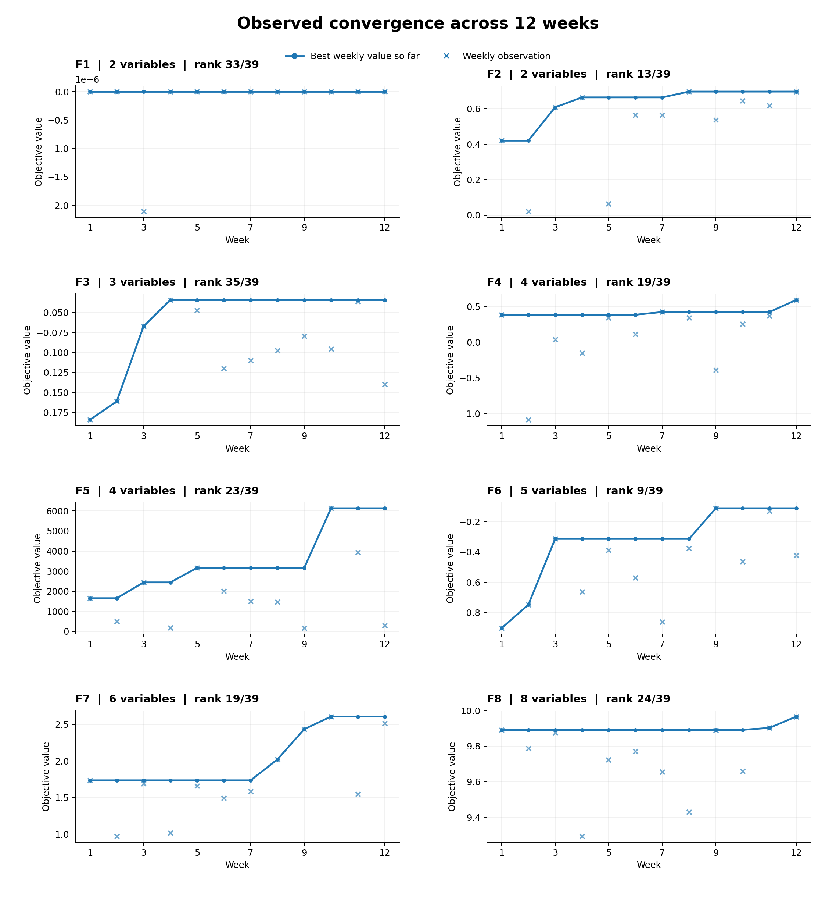
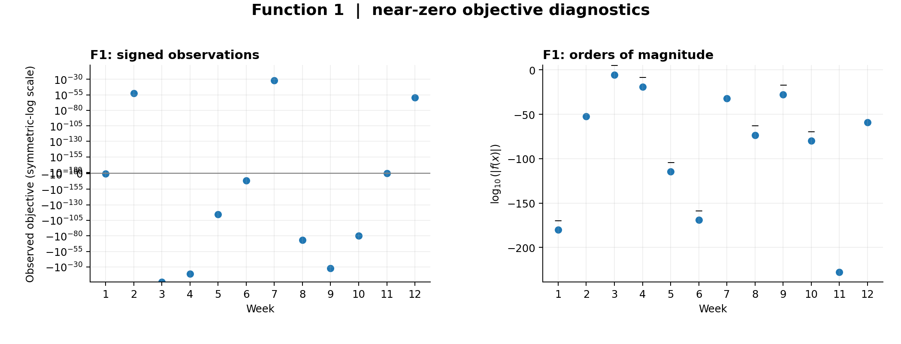
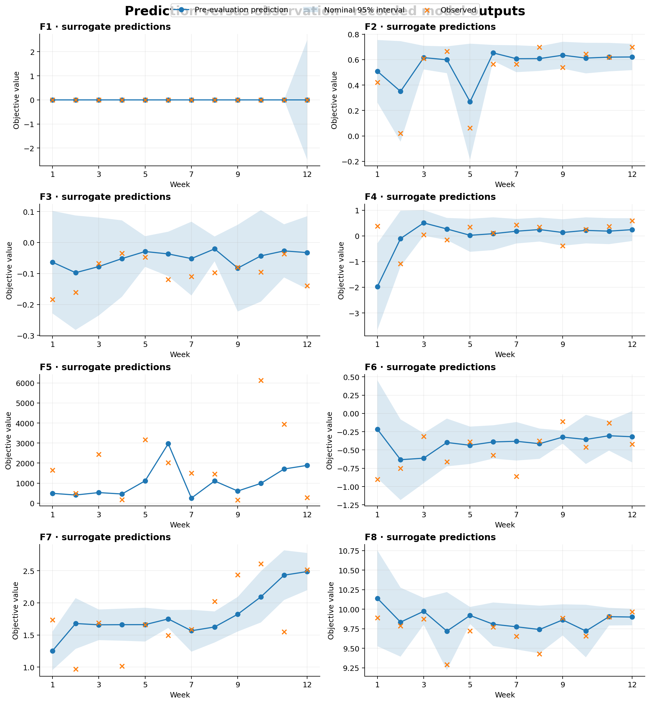

# Results dashboard

This dashboard summarises the **12 weekly evaluations** of eight black-box functions. It is based on the recorded observations and predictions in [`weekly_observations.csv`](weekly_observations.csv).

> **Scope:** Running best values include the **12 weekly evaluations only**, not the initial experimental design. Leaderboard ranks were supplied separately and are not calculated from the observations.

## Observed convergence



The line is the running maximum of the 12 weekly observations, and the crosses show the individual evaluations. Each function has its own vertical scale; the values are not directly comparable between functions.

| Function | Dimensions | Best week | Best weekly observation | Rank / 39 |
|---|---:|---:|---:|---:|
| F1 | 2 | 7 | 8.6068e-33 | 33 |
| F2 | 2 | 12 | 0.697246 | 13 |
| F3 | 3 | 4 | -0.0342692 | 35 |
| F4 | 4 | 12 | 0.591293 | 19 |
| F5 | 4 | 10 | 6136.6515 | 23 |
| F6 | 5 | 9 | -0.111471 | 9 |
| F7 | 6 | 10 | 2.606740 | 19 |
| F8 | 8 | 12 | 9.966392 | 24 |

## Function 1: near-zero objective values



F1's observed values span many orders of magnitude and include negative values. The left panel uses a symmetric-log axis to preserve sign; the right panel shows `log10(abs(objective))`, with minus signs marking negative observations. These transformations are **for visualisation only** and do not modify the optimisation data. They also do not demonstrate that a transformed GP would perform better.

## Surrogate predictions and observations



Lines show recorded predictive means, shaded bands represent mean ± 1.96 times the recorded predictive standard deviation, and crosses indicate observed objective values. These are **nominal intervals**, not validated coverage guarantees. In particular, the meaning and scaling of F5's recorded uncertainty values should be checked before drawing calibration conclusions.

## Interpretation and limitations

- F2, F4 and F8 reached their best **weekly** observation in Week 12, while F3 reached it in Week 4.
- F1's near-zero objective values make percentage errors unsuitable and ordinary linear plots uninformative.
- The figures are descriptive, not proof that GP–UCB outperforms other strategies.
- Initial-design observations are not included in the running-best curves. Complete optimisation trajectories require incorporating those observations with verified ordering.

## Reproduce the figures

The CSV and Python script are in this folder. Install `numpy` and `matplotlib`, then run:

```bash
python build_dashboard.py
```

This regenerates the three PNG figures from `weekly_observations.csv` without requiring the original Excel workbook.
