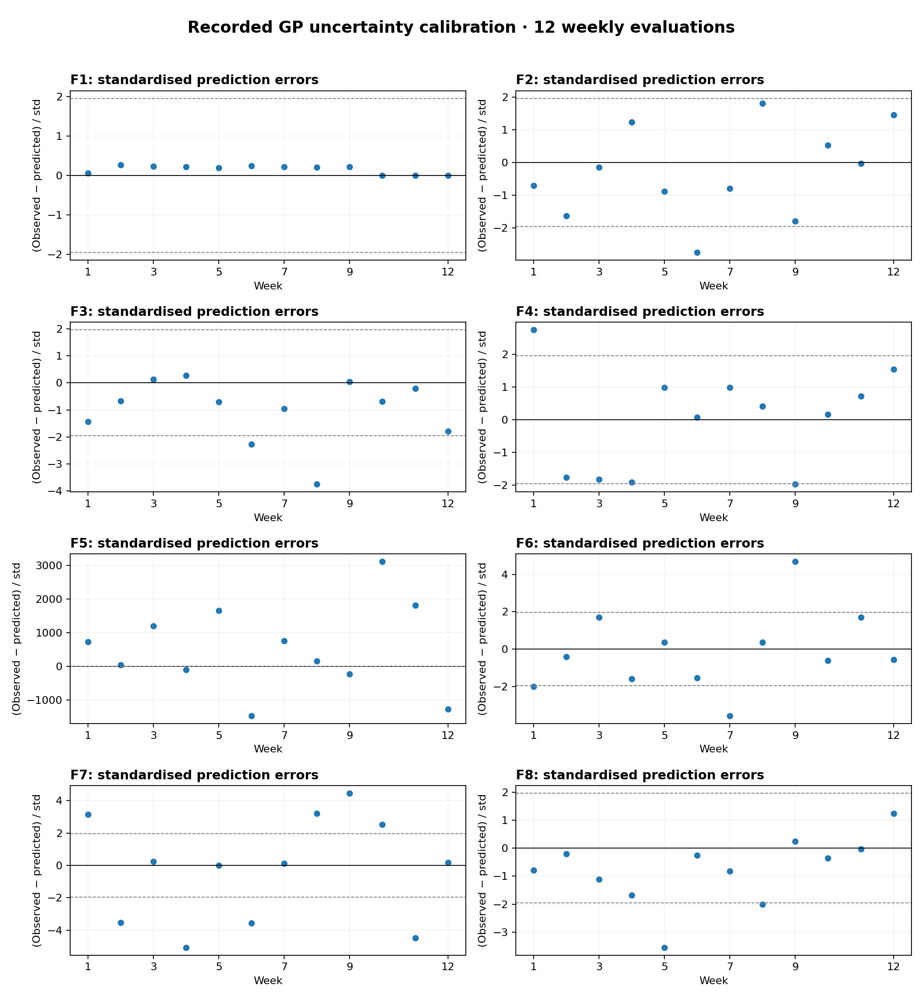

# Phase 3 — Gaussian Process predictive diagnostics

This report evaluates the **recorded** predictive means and standard deviations against the 12 weekly objective evaluations for each of eight functions.

## Reproduction

From the `results-dashboard` directory, run:

```bash
python diagnostics/gp_validation.py
```

Requires NumPy and Matplotlib. The script reads `../weekly_observations.csv` relative to its own location (`results-dashboard/weekly_observations.csv`) and creates `diagnostics/validation_metrics.csv` and `diagnostics/figures/standardised_residuals.png`.

## Metrics

- Error: `observed_value - predicted_mean`.
- MAE and RMSE are computed in each function's original objective units; **do not compare their magnitudes across functions**.
- Standardised error: `z = error / predicted_std`.
- Nominal 95% interval coverage: fraction satisfying `abs(z) <= 1.96`, assuming Gaussian predictive errors and valid original-scale standard deviations.
- Mean nominal interval width: `3.92 * predicted_std`.

## Results

| Function | MAE | RMSE | Nominal 95% coverage |
|---|---:|---:|---:|
| F1 | 0.000147 | 0.000177 | 12/12 (100%) |
| F2 | 0.09369 | 0.1280 | 11/12 (91.7%) |
| F3 | 0.05163 | 0.06441 | 10/12 (83.3%) |
| F4 | 0.4999 | 0.7914 | 10/12 (83.3%) |
| F5 | 1456 | 1961 | 0/12 (0%) |
| F6 | 0.2260 | 0.2903 | 9/12 (75%) |
| F7 | 0.3809 | 0.4822 | 4/12 (33.3%) |
| F8 | 0.1371 | 0.1869 | 10/12 (83.3%) |



## Interpretation and limitations

F5 and F7 have especially poor empirical coverage. This is a reason to audit the recorded uncertainty calculation, including any target standardisation, nonlinear transformation, noise convention, and whether the predictive mean and standard deviation refer to the same model and evaluation point.

F1's high coverage alone does not demonstrate good surrogate discrimination because most responses are extremely close to zero and the uncertainty intervals can be wide. Its MAE/RMSE are dominated by the surrogate's predicted mean, not the tiny response magnitudes.

**Critical verification:** the CSV does not establish whether predictions were generated *before* the corresponding evaluations. These results are labelled *recorded-prediction diagnostics*, not validated prospective performance, until prediction provenance is confirmed.

With only 12 evaluations per function, empirical coverage is noisy and observations are sequentially dependent. Avoid treating the nominal 95% level as a formal statistical test. Kernel length-scale histories and candidate coordinates are not present in this CSV, so kernel stability and acquisition-function selection cannot yet be evaluated.

## Next steps

1. Confirm predictive mean/std were stored before each new black-box evaluation, and verify units/transforms.
2. Audit F5 and F7 uncertainty calculations against the original optimisation code.
3. Add initial-design data, proposed candidate coordinates, acquisition scores and kernel parameters for each round.
4. Only then compare alternative surrogate/acquisition configurations under a controlled evaluation budget.
