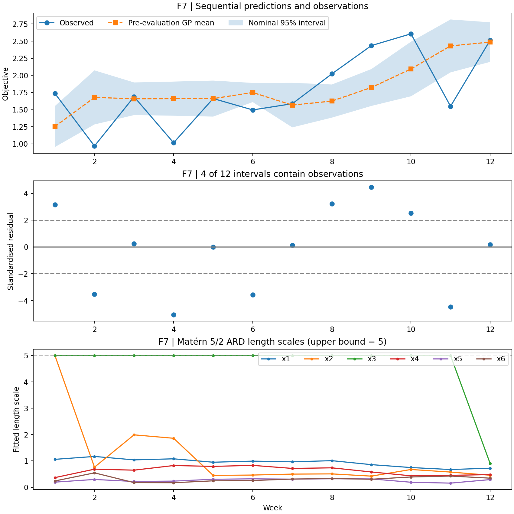

# F7 — Focused sequential GP diagnostics

## Scope and provenance

This report analyses the **existing Phase 4 sequential reconstruction** for Function 7. It does not rerun hyperparameter optimisation or demonstrate better future optimisation. The reconstruction used two kernel optimiser restarts; the original script specified ten. Predictions were made at each **actual evaluated point**, with only preceding observations used for GP training. The evaluated points are not independently verified as the historical acquisition recommendations.

## Key results

- 12 sequential evaluations; MAE **0.3809**, RMSE **0.4822** (objective units).
- Nominal 95% interval coverage: **4/12 = 33.3%**; **8/12** outside.
- Mean absolute standardised residual: **2.545**.
- Large positive residuals in weeks **8–10** indicate underprediction during the most productive observed phase; negative residuals in weeks **2, 4, 6 and 11** indicate overprediction. This is not a single-direction bias.
- The third input dimension's fitted Matérn length scale is at its **upper bound of 5 in weeks 1–11**; in week 12 it falls to **0.906**. This indicates a potentially weakly identified dimension and/or unstable hyperparameter fit, not proof that the third input is irrelevant.
- The fitted WhiteKernel noise level is close to its lower bound during early weeks and increases at weeks 7–10, then falls again. Its interpretation depends on whether evaluations are noisy or deterministic.

## Interpretation

The reconstructed GP intervals are **under-dispersed** at the evaluated points. A single fitted kernel cannot be declared the sole cause: small data, kernel misspecification, hyperparameter optimisation, and nonstationarity or abrupt local response changes are plausible explanations. Twelve evaluations are insufficient for a precise estimate of long-run 95% coverage.

## Priority before submission

1. Label these results **exploratory reconstruction (two restarts)**, not an exact reproduction of the original historical models.
2. Preserve the original evaluations and document the fitted hyperparameter behaviour.
3. Reserve Matérn/RBF comparisons and acquisition-policy experiments for a future extension unless the original GP settings can be matched and rerun.

## Reproduction

This report is based on `results-dashboard/diagnostics/sequential-audit/results/sequential_predictions.csv` and can be regenerated by running `python plot_f7.py` from this folder after the `sequential-audit` directory is uploaded as documented.
